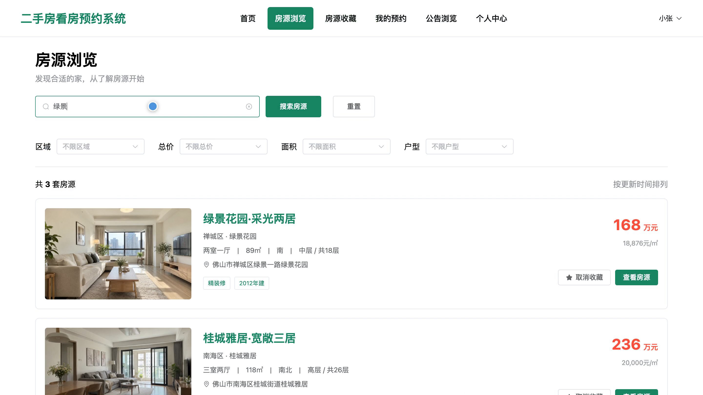
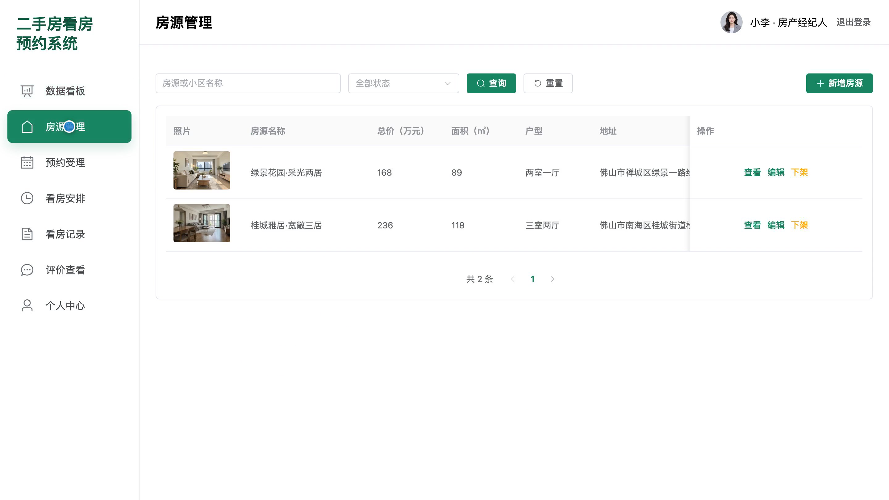
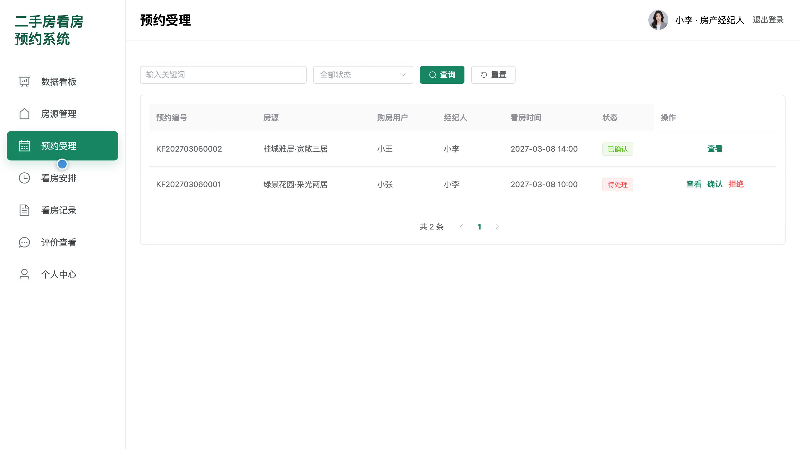
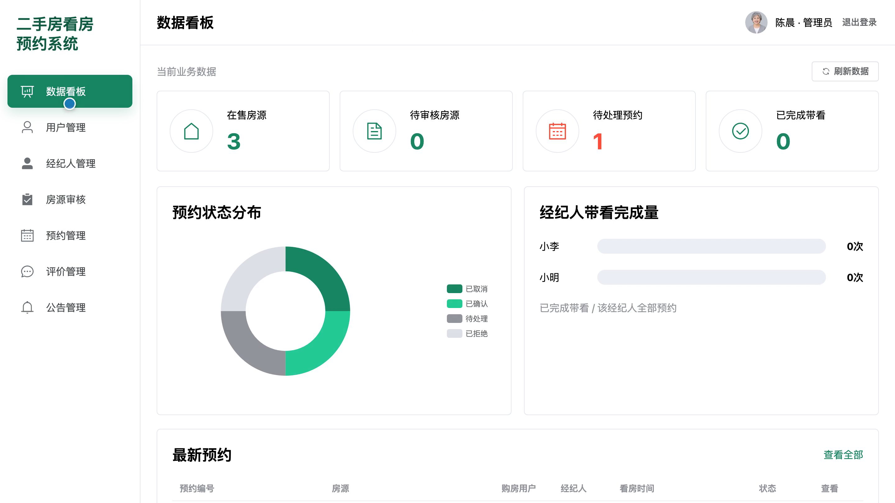
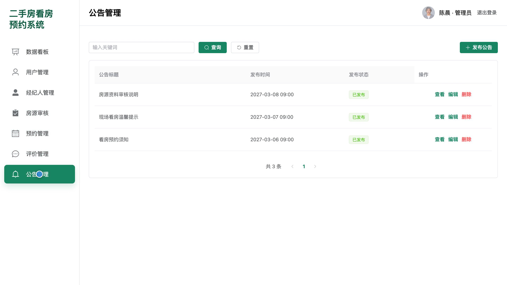

# bs155A
bs155A二手房看房预约系统源码 Java SpringBoot3 Vue3 前后分离
## 源码问题查看主页咨询

### 一、关键词
二手房、房源查找、看房预约、房产经纪、房源审核

### 二、作品包含
源码+数据库+全套环境和工具资源+本地部署教程

### 三、项目技术
前端技术： Html、Css、Js、Vue3.4、Element-Plus
后端技术：Java、SpringBoot3.2.0、MyBatis-Plus

### 四、运行环境要求
开发工具：IDEA/eclipse + VSCODE

数据库：MySQL5.7（共10张表）

数据库管理工具：Navicat10以上版本

环境配置软件： JDK17 + Maven3.6

前端Nodejs：>=20.19.0

浏览器：谷歌浏览器

### 五、项目介绍
项目编号：bs155A

二手房看房预约系统支持购房用户筛选和收藏房源、选择经纪人的可约时段并提交看房申请；房产经纪人维护房源、受理预约和记录带看结果；管理员审核房源并管理账号、预约、评价和公告。

角色：购房用户、房产经纪人、管理员

购房用户功能：房源检索与筛选、房源详情浏览、房源收藏管理、可约时段选择与看房预约、我的预约查询与取消、看房完成后评价提交、公告浏览、个人资料管理。

房产经纪人功能：预约数据看板、本人房源发布与维护、预约确认与拒绝、可约时段安排、带看完成与爽约记录、服务评价阅读、个人资料管理。

管理员功能：预约数据看板、购房用户管理、房产经纪人管理、房源审核与下架、平台预约管理、评价展示管理、公告发布与维护。

### 六、运行截图

